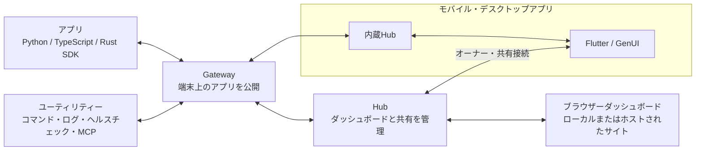

# omochi-ui

[English](README.md) · 日本語

Python・TypeScript・Rustのプログラムに、ブラウザーで操作できるUIを追加できます。
アプリケーションの言語で状態・アクション・ビューを定義し、
複数のアプリのビューを1つのダッシュボードにまとめられます。

## 全体の仕組み



接続を通じてビューの更新とユーザー操作をやり取りします。
`omochi-ui hub`はローカルGatewayを自動起動します。
Flutterアプリは内蔵Hubを使うか、外部Hubへ接続できます。

## 使う

LinuxまたはmacOSとNode.js 22以上で起動します。

```sh
npx @omochi-ui/cli hub
```

http://127.0.0.1:5555/ を開き、実行中のアプリのビューを追加してください。

[はじめに](https://omochi.fyi/docs/start/installation/) ·
[ユーティリティー](https://omochi.fyi/docs/guides/utils/)

## プログラムにUIを追加する

[SDKガイド](https://omochi.fyi/docs/guides/sdks/)に従うか、
コーディングエージェント用の連携スキルをインストールします。

```sh
npx skills add omochi-ui/omochi --skill omochi-integrate
```

## ソースから開発する

Bun 1.4.3以上と安定版Rustを用意し、リポジトリーのcheckoutで実行します。

```sh
bun install --frozen-lockfile
bun run quickstart
```

[コントリビュート](CONTRIBUTING.md) ·
[アーキテクチャ](docs/architecture.md) ·
[仕様一覧](spec/README.md)

## ライセンス

[Apache-2.0](LICENSE)
