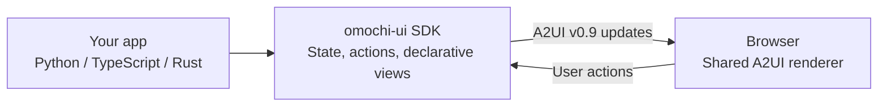

# omochi-ui

*プログラムに餅みたいにUIをくっつける — attach a UI to your program.*

Build interactive browser UIs from **Python, TypeScript, or Rust**. Define state,
actions, and views in your application's language; omochi-ui turns them into
A2UI v0.9 messages and renders them in the browser.

Use it to add controls to a script, preview a single application, or compose
surfaces from several running applications into a dashboard. Application state
and callbacks stay in the host process. The browser owns unfinished form input.

## How it fits together



The connection can be a development bridge, a direct transport, or a gateway and
hub. The SDKs share a protocol and conformance fixtures, rather than a binary.
See [Architecture](docs/architecture.md) for the complete system map and detailed
diagrams of dependencies, protocols, state, and recovery.
[Open the full-size system map](docs/diagrams/architecture-overview.svg).

## Quick start

Run these commands from a source checkout. JavaScript packages are managed with
**Bun 1.4.3+** (the baseline is pinned in `package.json` and `.bun-version`).
Node.js is not required. The Python example needs **Python 3.11+**
and **uv**. Discovery and Unix socket examples need a Unix-like environment.

```sh
git clone https://github.com/k-kozika/omochi.git
cd omochi
bun install --frozen-lockfile
bun run quickstart
```

The quickstart builds the workspace, starts a local development dashboard, and
opens it in the browser. Start the preview server from its control panel and
watch the health view recover. The preset is temporary; choose **Save as
dashboard** to keep and customize it. See the
[quickstart guide](examples/quickstart/README.md) to connect an MCP agent and add
its live surface to the same dashboard. Stop everything with Ctrl+C.

To develop one SDK example against the standalone preview instead, build first:

```sh
bun run build
```

In terminal 1, start the browser preview:

```sh
bun run --filter @omochi-ui/dev-server dev
```

In terminal 2, start the Python app and its WebSocket bridge:

```sh
bun run omochi-ui dev -- uv run --project examples/python examples/python/app.py
```

Open **http://127.0.0.1:5173/**. The preview connects to the bridge on port 5555;
you should see the example's controls. Stop both processes with Ctrl+C.

`dev` launches your application and a bridge. The browser preview is a separate
server. If either port is occupied, see [CLI troubleshooting](packages/cli/README.md#troubleshooting).

Other examples use the same preview:

| SDK | Command for terminal 2 | Additional tools |
| --- | --- | --- |
| TypeScript | `bun run omochi-ui dev -- bun run --cwd examples/typescript start` | Bun (used by the example) |
| Rust | `bun run omochi-ui dev -- cargo run --manifest-path examples/rust/Cargo.toml` | Rust 1.85+ and Cargo |

See the [SDK guide](docs/sdk.md) for code examples, state, actions, components,
and transports in all three languages.

The [agent approval example](examples/agent-approval/README.md) provides a shared
Approve/Reject panel for Codex, Claude Code, Cursor, and OpenCode tool hooks,
including optional rejection notes and an agent-free demo.

## Choose a command

All commands below are invoked with `bun run omochi-ui` from this checkout.

| I want to… | Command | What it starts or changes |
| --- | --- | --- |
| Start a composed project preset | `up --open [FILE]` | Declared services + hub + temporary dashboard preset |
| Preview one app | `dev -- <command> [args...]` | App process + WebSocket bridge; start the preview separately |
| Arrange running apps into dashboards | `hub` | Dashboard server + local gateway if needed |
| Make this machine's apps available to a hub | `gateway` | Discovery and routing; apps must already be running |
| View apps on another machine over SSH | `hub --ssh user@host` | Local dashboard + SSH forward to an existing remote gateway |
| Connect machines over paired TLS | `pair HOST:PORT` | Saves trust after entering a gateway's pairing code |
| Show this machine's identity | `id` | Creates an identity on first use, then prints it |
| Inspect or remove trusted peers | `trust list` / `trust forget <nodeId>` | Reads or changes local trust |
| Generate custom catalog bindings | `generate catalog` | Writes bindings for selected SDK languages |

```sh
bun run omochi-ui --help
bun run omochi-ui dev --help
bun run omochi-ui help hub
```

The [CLI reference](packages/cli/README.md) lists all options, defaults, and examples.

For lightweight entry points, [@omochi-ui/utils](packages/utils/README.md) can publish
command buttons, watches, processes, logs, streams, HTTP health views, or
agent-created A2UI surfaces over MCP:

```sh
bun run omochi-utils button --name "Build" -- bun run build
bun run omochi-utils watch --diff --interval 2s -- git status --short
bun run omochi-utils http http://127.0.0.1:3000/health
bun run omochi-utils mcp  # stdio MCP server, launched by your agent
```

Both publish ordinary discoverable services for the gateway and dashboard.

## Multiple apps in one dashboard

The bundled examples switch from stdio to a discoverable Unix socket when
`OMOCHI_SERVICE` is set. Start an app in one terminal:

```sh
OMOCHI_SERVICE=python-example uv run --project examples/python examples/python/app.py
```

Start the hub in another:

```sh
bun run omochi-ui hub
```

Open **http://127.0.0.1:5555/**, create a dashboard, add a surface, and save.
The hub serves its own UI and starts a local gateway automatically. It discovers
running apps; it does not launch them. A surface is an independently placeable
view published by an app.

`hub` and `dev` both default to port 5555. Stop the bridge before running this
example, or choose another port with `--port`.

See [Discovery and dashboards](docs/discovery.md) for multiple machines, SSH,
LAN pairing, storage, and the dashboard API. Network discovery and remote gateway
listeners are off by default. The development bridge and hub bind to loopback
and have no authentication or TLS.

## Documentation and development

| Read | For |
| --- | --- |
| [Architecture](docs/architecture.md) | Runtime flow, process diagrams, ownership, and package map |
| [SDK guide](docs/sdk.md) | Python, TypeScript, Rust, components, and transports |
| [CLI reference](packages/cli/README.md) | Commands, flags, defaults, and troubleshooting |
| [Discovery and dashboards](docs/discovery.md) | Local services, remote access, and routing |
| [Contributing](CONTRIBUTING.md) | Setup, tests, and change guidelines |

The repository contains SDKs under `packages/sdk/<lang>/` and tools under
`packages/`, runnable applications under `examples/`, and shared protocol
contracts and fixtures under `spec/`.
The CLI and browser applications can run from this workspace. The CLI is also
available on npm as `@omochi-ui/cli` and requires Bun 1.4.3+ even when installed
through npm.

## License

Licensed under the [Apache License 2.0](LICENSE).
