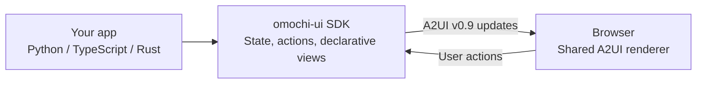

# omochi-ui

*プログラムに餅みたいにUIをくっつける — attach a UI to your program.*

Build interactive browser UIs from **Python, TypeScript, or Rust**. Define state,
actions, and views in your application's language; omochi-ui turns them into
A2UI v0.9 messages and renders them in the browser.

Use it to add controls to a script, preview a single application, or compose
surfaces from several running applications into a dashboard. Application state
and callbacks stay in the host process. The browser owns unfinished form input.

The native implementation lives in [`crates/`](crates/README.md). npm CLI packages
are thin stubs in [`packages/npm/`](packages/npm/README.md); SDKs and browser
packages retain their existing directories. Cargo owns native versions and behavior.

## How it fits together



The connection can be a development bridge, a direct transport, or a gateway and
hub. The SDKs share a protocol and conformance fixtures, rather than a binary.
See [Architecture](docs/architecture.md) for the complete system map and detailed
diagrams of dependencies, protocols, state, and recovery.
[Open the full-size system map](docs/diagrams/architecture-overview.svg).

## Quick start

On Linux or macOS with Node.js 22+, start the dashboard from any directory:

```sh
npx @omochi-ui/cli hub
```

Open **http://127.0.0.1:5555/**. The browser UI is bundled, and the hub starts a
local gateway automatically. Keep this terminal running. No repository clone,
Bun, Rust compiler, or separate frontend server is needed for the npm package.

Already running an SDK app or a utility? Create a dashboard, choose **Add view**,
and select its surface. SDK apps must publish through `UnixSocketServerTransport`
for local discovery; plain `app.start()` uses stdio. See the
[SDK transport guide](https://omochi.fyi/en/docs/guides/sdks/#transports).

To try a surface without writing an app, run in a second terminal:

```sh
npx @omochi-ui/utils watch --interval 2s -- date
```

Add its surface to the dashboard. Stop each process with Ctrl+C.

For regular use, install the CLI once:

```sh
npm install -g @omochi-ui/cli
omochi-ui hub
```

Or install it with current stable Rust/Cargo:

```sh
cargo install omochi-cli --locked
omochi-ui hub
```

`omochi-cli` installs the `omochi-ui` command, including both `hub` and `gateway`.
The `omochi-ui` Cargo crate is the SDK. Install utilities separately with
`npm install -g @omochi-ui/utils` or `cargo install omochi-utils --locked`.
For machines without Node or Rust, use a
[native release archive](crates/DISTRIBUTION.md).

Use a separate `gateway` command when apps run on another machine; follow the
[remote connection guide](https://omochi.fyi/en/docs/guides/remote/).
For local use, starting `hub` is enough.

## Agent skill

Install the integration skill in the project where you want to add an omochi UI:

```sh
npx skills add omochi-ui/omochi --skill omochi-integrate
```

Then ask your agent to use `omochi-integrate` to attach a UI to your program
(in Codex: `$omochi-integrate`). The skill covers Python, TypeScript, and Rust,
including state, form input, actions, progress, and browser connections.
Skill installation does not install the SDK or native CLI.

The skill lives in [`skills/omochi-integrate/`](skills/omochi-integrate/SKILL.md),
a standard [Skills CLI discovery location](https://github.com/vercel-labs/skills/blob/main/docs/creating-skills.md#skill-discovery).
To inspect skills from a local checkout before publishing changes:

```sh
npx skills add . --list
```

## Choose a command

Use `omochi-ui` after installation, or `npx @omochi-ui/cli` without a global install.
From a built source checkout, use `bun run omochi-ui`.

| I want to… | Command | What it starts or changes |
| --- | --- | --- |
| Start a composed project preset | `up --open [FILE]` | Declared services + hub + temporary dashboard preset |
| Preview one app | `dev -- <command> [args...]` | App process + WebSocket bridge; start the preview separately |
| Arrange running apps into dashboards | `hub` | Dashboard server + local gateway if needed |
| Make this machine's apps available to a hub | `gateway` | Discovery and routing; apps must already be running |
| Connect machines with an invitation | `pair --name workstation` | Imports the gateway invitation on this PC; registered gateways reconnect automatically |
| Inspect remote gateway connections | `status` | Reads registered names and connection diagnostics from the running hub |
| Show this machine's identity | `id` | Creates an identity on first use, then prints it |
| Inspect or remove trusted peers | `trust list` / `trust forget <nodeId>` | Reads or changes local trust |
| Generate custom catalog bindings | `generate catalog` | Writes bindings for selected SDK languages |

```sh
npx @omochi-ui/cli --help
npx @omochi-ui/cli dev --help
npx @omochi-ui/cli help hub
```

The [CLI reference](https://omochi.fyi/en/docs/reference/cli/) lists all options, defaults, and examples.

For lightweight entry points, [@omochi-ui/utils](https://omochi.fyi/en/docs/reference/utils/) can publish
command buttons, watches, processes, logs, streams, HTTP health views, or
agent-created A2UI surfaces over MCP:

```sh
npx @omochi-ui/utils button --name "Build" -- bun run build
npx @omochi-ui/utils watch --diff --interval 2s -- git status --short
npx @omochi-ui/utils http http://127.0.0.1:3000/health
npx @omochi-ui/utils mcp  # stdio MCP server, launched by your agent
```

Both publish ordinary discoverable services for the gateway and dashboard.

## Multiple apps in one dashboard

The bundled examples switch from stdio to a discoverable Unix socket when
`OMOCHI_SERVICE` is set. Start an app in one terminal:

```sh
OMOCHI_SERVICE=python-example uv run --project examples/python examples/python/app.py
```

Start the hub in another:

```sh
npx @omochi-ui/cli hub
```

Open **http://127.0.0.1:5555/**, create a dashboard, add a surface, and save.
The hub serves its own UI and starts a local gateway automatically. It discovers
running apps; it does not launch them. A surface is an independently placeable
view published by an app.

`hub` and `dev` both default to port 5555. Stop the bridge before running this
example, or choose another port with `--port`.

See [Dashboard guide](https://omochi.fyi/en/docs/guides/dashboards/) for composing apps and
[remote connections](https://omochi.fyi/en/docs/guides/remote/) for pairing machines. Network discovery and remote gateway
listeners are off by default. The development bridge and hub bind to loopback
and have no authentication or TLS.

## Documentation and development

[Documentation](https://omochi.fyi/en/docs/) · [日本語](https://omochi.fyi/docs/) · [Website development](apps/site/README.md)

| Read | For |
| --- | --- |
| [Architecture](docs/architecture.md) | Runtime flow, process diagrams, ownership, and package map |
| [SDK guide](https://omochi.fyi/en/docs/guides/sdks/) | Python, TypeScript, Rust, components, and transports |
| [CLI reference](https://omochi.fyi/en/docs/reference/cli/) | Commands, flags, defaults, and troubleshooting |
| [Discovery and dashboards](https://omochi.fyi/en/docs/guides/remote/) | Local services, remote access, and routing |
| [Hosted dashboard sharing](docs/dashboard-sharing.md) | Hub-client iroh access, identity invitations and readonly public links |
| [Docker](deploy/docker/README.md) | Run the hub and Python example with Compose; native images on GHCR |
| [Deployment](deploy/README.md) | app.omochi.fyi static hosting, hub setup and relay operation |
| [Browser dashboard experiment](experiments/browser-dashboard/README.md) | Opt-in browser-resident hub, WASM transport, and direct gateway tests |
| [Design system](docs/design-system.md) | Shared palette, tokens, components, and connection states |
| [Contributing](CONTRIBUTING.md) | Setup, tests, and change guidelines |

The repository contains SDKs under `packages/sdk/<lang>/` and tools under
`packages/`, runnable applications under `examples/`, and shared protocol
contracts and fixtures under `spec/`.
The CLI and utilities ship as native archives with the dashboard embedded.
[Native registry releases](docs/native-releasing.md) also prepare `omochi-cli` /
`omochi-utils` on crates.io and retain `@omochi-ui/cli` / `@omochi-ui/utils` on npm.
See the [native distribution guide](crates/DISTRIBUTION.md) for
installation and pairing. Bun is a source-build tool, not a service runtime.
`bun run build:native:release` builds an archive for the current host.

## Develop from source

Run these commands from a source checkout. JavaScript packages are managed with
**Bun 1.4.3+** (the baseline is pinned in `package.json` and `.bun-version`).
Building the native CLI and utilities also needs **current stable Rust and Cargo**.
Node.js is not required. The Python example needs **Python 3.11+**
and **uv**. Discovery and Unix socket examples need a Unix-like environment.

```sh
git clone https://github.com/omochi-ui/omochi.git
cd omochi
bun install --frozen-lockfile
bun run quickstart
```

The quickstart builds the workspace, starts a local development dashboard, and
opens it in the browser. Start the preview server from its control panel and
watch the health view recover. The preset is temporary; choose **Save as
dashboard** to keep and customize it. See the
[quickstart guide](examples/quickstart/README.md) to connect an MCP agent and add
its live surface to the same dashboard. Stop everything with Ctrl+C.

To develop one SDK example against the standalone preview instead, build first:

```sh
bun run build
bun run build:native
```

In terminal 1, start the browser preview:

```sh
bun run --filter @omochi-ui/dev-server dev
```

In terminal 2, start the Python app and its WebSocket bridge:

```sh
bun run omochi-ui dev -- uv run --project examples/python examples/python/app.py
```

Open **http://127.0.0.1:5173/**. The preview connects to the bridge on port 5555;
you should see the example's controls. Stop both processes with Ctrl+C.

`dev` launches your application and a bridge. The browser preview is a separate
server. If either port is occupied, see [CLI troubleshooting](https://omochi.fyi/en/docs/understand/troubleshooting/).

Other examples use the same preview:

| SDK | Command for terminal 2 | Additional tools |
| --- | --- | --- |
| TypeScript | `bun run omochi-ui dev -- bun run --cwd examples/typescript start` | Bun (used by the example) |
| Rust | `bun run omochi-ui dev -- cargo run --manifest-path examples/rust/Cargo.toml` | Rust 1.85+ and Cargo |

See the [SDK guide](https://omochi.fyi/en/docs/guides/sdks/) for code examples, state, actions, components,
and transports in all three languages.

The [agent approval example](examples/agent-approval/README.md) provides a shared
Approve/Reject panel for Codex, Claude Code, Cursor, and OpenCode tool hooks,
including optional rejection notes and an agent-free demo.

## License

Licensed under the [Apache License 2.0](LICENSE).

To add a gateway from your browser, run `omochi-ui gateway --remote --pair`.
Open the printed app.omochi.fyi URL or scan its QR, connect your owner hub,
and choose **Add to this hub**. Invitations expire in 180 seconds.
Use `--web-url https://your-dashboard.example/` for a custom hosted client.
CLI `omochi-ui pair` also accepts the HTTPS invitation URL.
