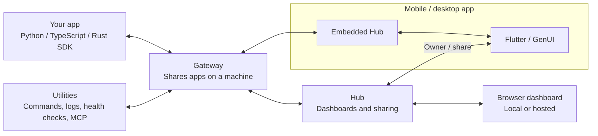

# omochi-ui

English · [Japanese](README.ja.md)

Attach interactive browser UIs to Python, TypeScript, and Rust programs.
Define state, actions, and views in your application's language.
Arrange views from multiple apps in one dashboard.

## How it fits together



Connections carry view updates and user actions. `omochi-ui hub` starts a local
Gateway automatically. The Flutter app can use its embedded Hub or connect to
an external Hub.

## Use it

On Linux, macOS or Windows 11 with Node.js 22+:

```sh
npx @omochi-ui/cli hub
```

Open http://127.0.0.1:5555/ and add views from running apps.

[Getting started](https://omochi.fyi/en/docs/start/installation/) ·
[Utilities](https://omochi.fyi/en/docs/guides/utils/)

## Add a UI to your program

Follow the [SDK guide](https://omochi.fyi/en/docs/guides/sdks/),
or install the integration skill for your coding agent:

```sh
npx skills add omochi-ui/omochi --skill omochi-integrate
```

## Develop from source

From a repository checkout, with Bun 1.4.3+ and stable Rust:

```sh
bun install --frozen-lockfile
bun run quickstart
```

[Contributing](CONTRIBUTING.md) ·
[Architecture](docs/architecture.md) ·
[Specifications](spec/README.md)

## License

[Apache-2.0](LICENSE)
