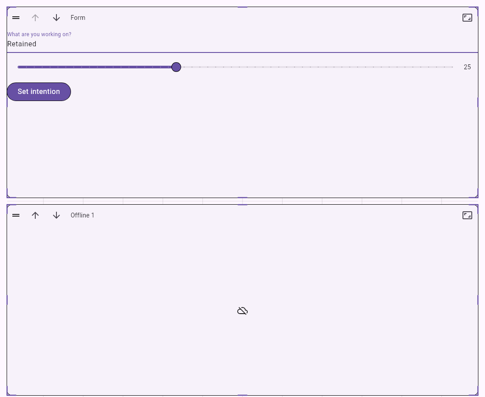
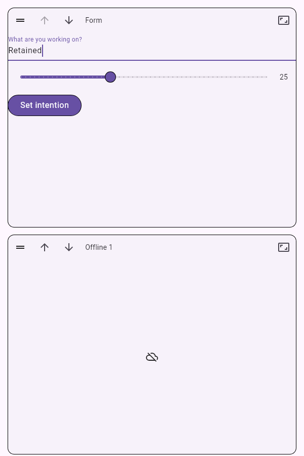

# Responsive dashboard layout

The external-Hub dashboard uses sliver_dashboard 2.8.0 above 760 logical pixels
and a reorderable list at narrower widths, including desktop windows. Wide grids
use 12 columns, 40px rows and 16px gaps. Only completed user edits change the draft;
resizing the window, importing a board or refreshing a connection never saves it.
Saved gaps remain visible until a grid interaction compacts the layout.

Drag the header grip to move a panel. Narrow touch layouts use long press;
mouse layouts start dragging immediately. Up/down buttons provide an alternative.
Narrow reorder packs the shared 12-column geometry in the requested order without
compacting it back into a different order. Panel sizes are preserved.

Size opens a staged sheet with width presets, shorter/taller controls and a
preview of the wide layout. Apply updates the draft; Save persists it. Cancel
closes the sheet without applying it. Narrow card heights are clamped to 320–600px;
the preview shows how size changes affect the shared wide layout.

GenUI widgets are retained across width changes and when scrolled offscreen.
Each visited panel owns a stable Surface host outside the replaceable slivers.
Composited body slots position those hosts; hidden hosts pause tickers and leave
focus and semantics traversal. A shared Scrollable keeps wheel and touch scrolling
working over application content. A render viewport bridge reveals focused inputs
when the keyboard opens and supports `Scrollable.ensureVisible`, including for
visited panels whose sliver slots are offscreen. Header grips authorize grid drags. Desktop edge
hit regions preserve native resizing; Android and iOS use Size and keep app input
active across the entire panel body. Delete and Backspace never remove panels;
owner membership controls remain the only removal path. The editor footer shrinks
with the available body height when the keyboard opens.

Escape, window width changes, refreshed board props and lifecycle interruptions
cancel both the layout controller and the active grid pointer session. Partial
drags and resizes revert without writing the draft; narrow reorders also cancel.

The runtime and image budgets still belong to HubSession. Retained card state is
released when the panel is removed or its owning viewport is disposed; a new
renderer ID replaces the inner Surface. Editing and app interaction permissions
remain independent. Shared editors cannot change panel membership.

## Validation (2026-11-10)

Automated coverage includes actual GenUI input state across wide/narrow switches
and offscreen scrolling in both breakpoint directions, state release after panel,
viewport or renderer replacement, desktop app input preserving saved gaps, native
resize, Android/iOS edge input and header drag, deletion-key vetoes, restored touch
grips after a failed save, a landscape keyboard, no layout writes on width changes,
native resize cancellation and recovery, keyboard and explicit viewport reveal,
touch-handle reorder, staged size application, geometry validation, metadata
preservation, pending writes and conflict handling. Screenshots below are widget-test fixtures using real fonts,
not captures of a running device app. Physical Android and desktop app interaction
have not been manually verified in this change.

Run `flutter analyze` and `flutter test` from `apps/mobile`. To regenerate preview
images under `/tmp`, run `flutter test test/board_layout_test.dart` with
`--dart-define=BOARD_SCREENSHOTS=true` and `--dart-define=BOARD_FONT_DIR=<Flutter SDK>/bin/cache/artifacts/material_fonts`.
