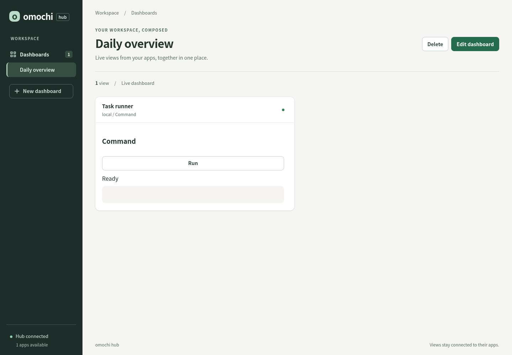
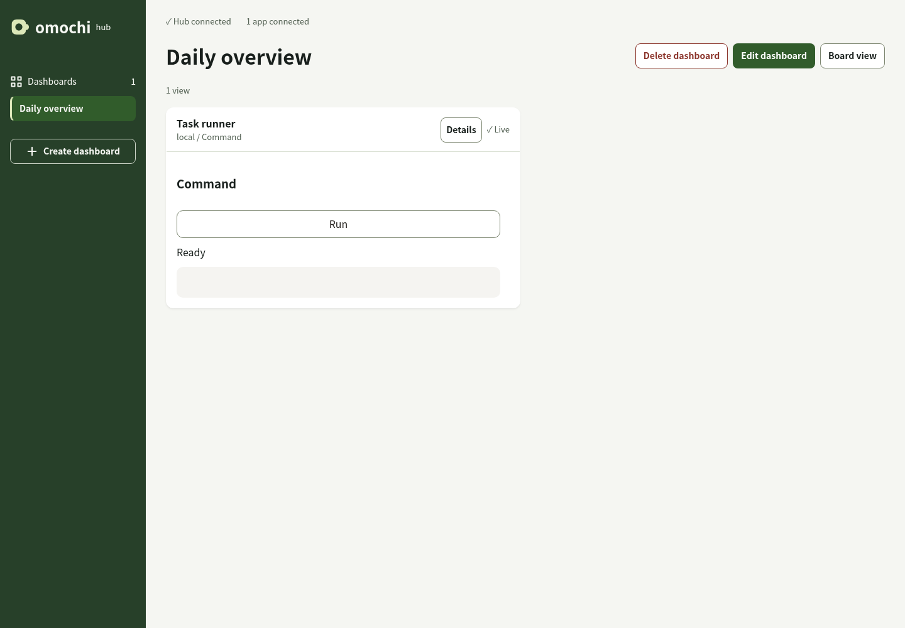

# Dashboard UI and board view

The dashboard follows [the design system](design-system.md). It uses the existing
React renderer and CSS; dashboard API and persisted panel geometry are unchanged.

## Screenshots

Same seeded dashboard before and after the change:




[Editing](assets/dashboard-ui/editing.png) · [Board view](assets/dashboard-ui/board.png) ·
[Mobile board after reordering](assets/dashboard-ui/mobile-board.png)

## Operations

- **Create dashboard** starts a draft. **Add view** lists connected app views by
  device and app; search has a clear action when nothing matches.
- **Save dashboard** validates names next to the input and keeps the draft on
  failure. A revision conflict never overwrites another client's dashboard.
  **Discard and reload** explicitly discards local edits after confirmation.
- **Cancel** and switching dashboards confirm only when the draft differs from
  its starting state. Deleting a dashboard requires confirmation; source apps
  and their views are not deleted.
- Removing a view offers **Undo removal**, with no timer. The next layout edit,
  add/remove, save or cancel ends that undo operation.
- Drag the grip to move a panel; drag any edge or corner to resize it. Preview
  geometry is derived from the starting layout, not the previous pointer event.
  Escape or pointer cancellation restores the starting geometry. The grid opts
  out of scroll anchoring, and movement accounts for document scrolling.
- **Adjust layout** provides buttons for moving and changing width/height without
  dragging. Arrow keys on the grip move one cell. Changes use the existing
  collision rule: the edited panel takes priority and overlapping panels move down.
- At 760px and below, **Move up / Move down** changes order and repacks the common
  desktop grid left to right, preserving panel sizes. Resizing the browser alone
  never changes saved geometry.
- **Details** exposes full view and source names without relying on hover titles.

## Board view

**Board view** hides navigation and editing controls, while preserving view
headers, connection information, live updates and app interactions. Long boards
scroll normally rather than shrinking. **Exit board view** is always available,
including when loading fails or the dashboard is empty.

Use `?dashboard=<id>&view=board` or `?preset=<id>&view=board` to bookmark this mode.
Exiting removes only `view`. It is a display mode, not an authorization boundary
or browser fullscreen mode. Switching modes preserves mounted Surface views.

## Reproduce the checks

```sh
bun install
bun run build:native
bun run --filter @omochi-ui/hub-ui test
bun run --filter @omochi-ui/hub-ui lint
bun run --filter @omochi-ui/renderer test
bun packages/hub-ui/test/browser.mjs
```

The browser script starts isolated native services and Chromium, uses real HTTP
and WebSocket traffic, and cleans up its temporary runtime and processes. It
requires local socket permissions. `CHROMIUM_BIN` selects Chromium and
`SCREENSHOT_DIR` selects the output directory (default
`/tmp/omochi-hub-screenshots`). `CAPTURE_ONLY=1` captures the initial seeded board
without assuming the new UI, allowing a baseline against an earlier binary.

Recorded verification: native/web build, hub-ui typecheck and lint passed;
hub-ui tests passed (10), renderer tests passed (4; opt-in native test skipped),
and the Chromium/native-service browser script passed. Vite retains its warning
about the renderer bundle exceeding 500kB. No server or wire-contract code changed.

The fixture is a dashboard named Daily overview with a Task runner view supplied
by a native button utility. The test also starts a second utility for mobile
reordering. Screenshots show the actual app rather than a mockup.

## Interface review

Scope: the dashboard shell, editing, picker, details and confirmation dialogs,
board view, and the basic embedded button fallback. Recon used `AGENTS.md`,
`CONTRIBUTING.md`, and `docs/design-system.md`. Custom application catalogs,
Flutter and the website are outside this review.

| Domain | Evidence inspected | Result |
| --- | --- | --- |
| Accessibility | App controls, native dialogs, browser accessibility tree, arrow/Escape interactions | Names and tested focus recovery verified; real screen-reader speech not verified |
| Layout | Desktop and 320px screenshots, mobile order, 200% text and RTL checks | No page overflow in tested states |
| Writing | App labels, errors, empty/search states, save conflict and discard flows | Recovery actions and destructive consequences made explicit |
| Typography | Host input sizes, wrapping, full values in Details | 16px input baseline; enlarged text inspected |
| Colors | Computed foreground/background pairs from Chromium | Measured body 15.46:1, secondary 6.13:1, primary 7.79:1, selected navigation 7.18:1 |
| UI | CSS state rules, reduced motion, forced colors, screenshots | Host transitions are 100ms, zero under reduced motion; static state cues retained |

Resolved root causes (locations are relative to `packages/hub-ui/src`):

| Severity | Domain | Location | Before | After | Why |
| --- | --- | --- | --- | --- | --- |
| HIGH | Writing | App.tsx:129 | Cancel immediately lost changes | Dirty-state confirmation | Prevent accidental loss |
| HIGH | Layout | App.tsx:286 | Full values depended on hover title | Keyboard/touch Details dialog | Make full names available |
| MEDIUM | Accessibility | App.tsx:142 | Empty names silently disabled saving | Inline error and invalid-input focus | Explain how to proceed |
| MEDIUM | Writing | App.tsx:325 | No filtered-empty explanation | Query-specific message and Clear search | Recover from an empty search |
| MEDIUM | Layout | App.tsx:305 | Coordinate inputs and bottom-right resize only | Edge/corner handles and non-drag controls | Direct and accessible adjustment |
| MEDIUM | UI | styles.css:26 | Generic button/input styles affected embedded apps | Scoped host selectors and renderer-owned neutral fallback | Keep shell and app styling independent |

Not verified: real assistive-technology speech, iOS/Safari touch behavior, browser
zoom distinct from text resizing, every custom app's styles, all hover/disabled
contrast combinations, and the exact original user-reported jumping sequence.
The regression suite covers pointer preview/cancellation and source-level layout
reversibility; it does not claim that the unspecified original sequence was reproduced.

Verdict: **Approve for the inspected states only**. The unverified checks above
remain explicit limitations, not claims of accessibility conformance.
