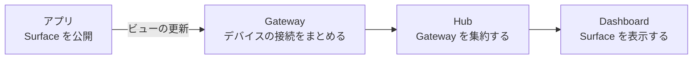

# Omochi デザインシステム

[Overview](../README.md) · [Architecture](architecture.md) · [Discovery and dashboards](discovery.md)

[issue #5](https://github.com/omochi-ui/omochi/issues/5) に対応する初期デザイン仕様。深い緑と明るい背景を基調に、操作と接続状態を読み取りやすい開発ツールを目指す。Web サイト、dashboard、開発プレビュー、将来の Flutter クライアントで、色の役割・文字・余白・部品の状態・用語を共有する。

この仕様の範囲はドキュメントと静的な見本図まで。既存 UI への適用、テーマのコード化、Flutter の実装は別途行う。初期仕様はライトの作業面と濃色のナビゲーションで構成し、全面ダークテーマは含めない。

[見本図を原寸で開く](assets/design-system.png) · [編集元 SVG](assets/design-system.svg) · [アイコンの編集とプレビュー](assets/design-system/README.md)。これは仕様の見本であり、実装済み画面のスクリーンショットではない。文書では生成した PNG を表示し、編集元 SVG は個別のアイコンファイルを参照する。

## デザインの原則

- **操作は明快に。** 読める文字、動詞で始まる操作名、目に見えるフォーカスを優先する。保存中・選択中・接続中は、色に加えて文字や形で示す。
- **接続を可視化する。** Surface・Gateway・Hub に固有の図形を割り当て、どの対象とつながっているかを名前とともに示す。Hub との接続だけで、配下のすべてが正常とは表現しない。
- **落ち着いた道具にする。** わらび餅や抹茶の印象は、緑、わずかに色づいた背景、適度な角丸で表す。マスコット、跳ねる動き、常時点滅する装飾は使わない。

## 色のトークン

色は「値を持つパレット」と「用途を持つセマンティックトークン」の二層に分ける。コンポーネントは用途の名前を参照する。以下のドット区切り名を共通の識別子とし、Web の変数名では `color.accent.solid` を `--omochi-color-accent-solid` と表す。

### 基調パレット

ユーザー指定の4色をそのまま使う。均等な明度の色階調としては扱わず、それぞれに役割を与える。

| パレット名 | 値 | 主な用途 |
| --- | --- | --- |
| `palette.ink` | `#181f1c` | 本文、強い見出し、押下中の主操作 |
| `palette.forest` | `#274029` | 濃色ナビゲーション、主操作の hover |
| `palette.leaf` | `#315c2b` | 主操作、リンク、選択の強調 |
| `palette.olive` | `#60712f` | 明るい面のフォーカス、補助的なブランド表現 |

オリーブはブランド色であり、警告の意味には使わない。主操作の塗りは `leaf` に統一する。

### 補助パレット

| パレット名 | 値 | 用途 |
| --- | --- | --- |
| `palette.white` | `#ffffff` | カード、入力、主操作上の文字 |
| `palette.paper` | `#f5f6f2` | ページ背景、濃色面上の文字 |
| `palette.mist` | `#edf2e8` | hover、選択、補助情報の背景 |
| `palette.line` | `#d6ddcf` | 装飾的な区切り、カード外枠 |
| `palette.sage` | `#7a846e` | 操作部品の境界 |
| `palette.slate` | `#526052` | 補足、placeholder、未接続の文字 |
| `palette.pale` | `#cbd3c6` | 濃色面上の補足文字 |
| `palette.lime` | `#dce8b9` | 濃色面のフォーカスと選択線 |
| `palette.amber` | `#745512` | 注意の文字とアイコン |
| `palette.amberWash` | `#fff7df` | 注意の背景 |
| `palette.red` | `#8b342b` | エラー、削除の文字とアイコン |
| `palette.redWash` | `#fff1ed` | エラー、削除操作の hover 背景 |

### 用途への割り当て

表の値は上記 `palette.*` の参照先。濃色ナビゲーションは独立した領域として扱い、明るい作業面の色を変更しない。

| トークン | 参照先 | 使用箇所 |
| --- | --- | --- |
| `color.bg.page` | `paper` | ページ全体 |
| `color.bg.surface` | `white` | カード、入力 |
| `color.bg.raised` | `white` | メニュー、ダイアログ |
| `color.bg.subtle` | `mist` | コード、補足情報 |
| `color.bg.inverse` | `forest` | ナビゲーション |
| `color.text.primary` | `ink` | 本文、見出し |
| `color.text.secondary` | `slate` | 補足、placeholder |
| `color.text.inverse` | `paper` | 濃色面の本文 |
| `color.text.inverseSecondary` | `pale` | 濃色面の補足 |
| `color.border.subtle` | `line` | 非操作カードの枠 |
| `color.separator` | `line` | 情報の区切り |
| `color.border.control` | `sage` | 入力、secondary ボタンの枠 |
| `color.accent.solid` | `leaf` | 主操作の塗り、濃色ナビの選択背景 |
| `color.accent.solidHover` | `forest` | 主操作の hover |
| `color.accent.solidPressed` | `ink` | 主操作の押下 |
| `color.accent.onSolid` | `white` | 主操作の文字 |
| `color.accent.text` | `leaf` | 下線つきリンク |
| `color.accent.subtle` | `mist` | 明るい面の選択背景 |
| `color.selection.indicator` | `leaf` | 明るい面の選択線 |
| `color.selection.inverseIndicator` | `lime` | 濃色面の選択線 |
| `color.focus` | `olive` | 明るい面の外側フォーカスリング |
| `color.focus.inverse` | `lime` | 濃色面の外側フォーカスリング |
| `color.disabled.bg` | `mist` | 無効な操作の背景 |
| `color.disabled.text` | `slate` | 無効な操作の文字 |
| `color.disabled.border` | `line` | 無効な操作の枠 |
| `color.status.positive.text` | `forest` | チェックと「接続済み」「保存済み」 |
| `color.status.positive.bg` | `mist` | 確認済み状態の背景 |
| `color.status.neutral.text` | `slate` | 未接続、接続中、状態不明 |
| `color.status.neutral.bg` | `paper` | 中立状態の背景 |
| `color.status.warning.text` | `amber` | 注意の文字・アイコン・必要な枠 |
| `color.status.warning.bg` | `amberWash` | 注意の背景 |
| `color.status.danger.text` | `red` | エラー、削除の文字・アイコン・枠 |
| `color.status.danger.bg` | `redWash` | エラーの背景 |

情報の状態には文字とアイコンを併記し、濃い塗りの面積は小さくする。赤いバッジを通常の未接続に使わない。濃色ナビゲーション内の状態は上記の明るいバッジ背景を持たせ、赤やオリーブの文字を濃色背景へ直接置かない。

### コントラスト

通常の文字は 4.5:1 以上、操作や状態の識別に必要な境界・図形は隣接色と 3:1 以上を確保する。見出しも原則として通常文字と同じ配色を使う。[W3C の文字コントラスト](https://www.w3.org/WAI/WCAG22/Understanding/contrast-minimum.html)と[非テキストのコントラスト](https://www.w3.org/WAI/WCAG22/Understanding/non-text-contrast.html)に基づく。

以下は不透明な sRGB 色の相対輝度から計算した比率。表示は小数第2位まで、合否は丸め前の値で判断する。

| 前景 | 背景 | 比率 | 用途と基準 |
| --- | --- | --- | --- |
| `#181f1c` | `#f5f6f2` | 15.46:1 | 本文、4.5:1 |
| `#526052` | `#f5f6f2` | 6.13:1 | 補足、4.5:1 |
| `#526052` | `#ffffff` | 6.66:1 | 入力の placeholder、4.5:1 |
| `#ffffff` | `#315c2b` | 7.79:1 | 主操作、4.5:1 |
| `#ffffff` | `#274029` | 11.34:1 | 主操作の hover、4.5:1 |
| `#ffffff` | `#181f1c` | 16.78:1 | 主操作の押下、4.5:1 |
| `#315c2b` | `#edf2e8` | 6.85:1 | 選択文字、4.5:1 |
| `#7a846e` | `#ffffff` | 3.92:1 | 入力の枠、3:1 |
| `#7a846e` | `#f5f6f2` | 3.61:1 | ページ上の操作枠、3:1 |
| `#60712f` | `#f5f6f2` | 4.96:1 | フォーカス、3:1 |
| `#f5f6f2` | `#274029` | 10.45:1 | 濃色ナビの文字、4.5:1 |
| `#cbd3c6` | `#274029` | 7.38:1 | 濃色ナビの補足、4.5:1 |
| `#dce8b9` | `#315c2b` | 6.04:1 | 濃色ナビの選択線、3:1 |
| `#8b342b` | `#fff1ed` | 7.26:1 | エラー、4.5:1 |
| `#745512` | `#fff7df` | 6.43:1 | 注意、4.5:1 |

`#315c2b` と `#274029` の差は **1.46:1**。濃色ナビの選択背景だけでは状態を示さず、3px の `inverseIndicator` と選択セマンティクスを添える。`color.border.subtle` は操作部品の識別に使わない。透明度で文字や状態全体を薄くせず、定義した色の組み合わせを保つ。

## 文字と寸法

### タイポグラフィ

UI は OS 標準の sans-serif を基本とする。Web の候補は `system-ui, -apple-system, BlinkMacSystemFont, "Segoe UI", "Hiragino Sans", "Yu Gothic UI", sans-serif`。既存の Inter は配信する書体がある場合に利用できる。コードと識別子は `ui-monospace, "SFMono-Regular", Consolas, monospace`。日本語も同じ役割のサイズを使い、本文の行間は 1.6 とする。

| トークン | 基準サイズ | 行高の倍率 | 太さ | 用途 |
| --- | --- | --- | --- | --- |
| `type.display` | 48 | 1.2 | 600 | Web サイトの短い主見出し。狭い幅では32 |
| `type.title` | 32 | 1.3 | 600 | ページ見出し。狭い幅では28 |
| `type.heading` | 24 | 1.3 | 600 | セクション見出し |
| `type.panel` | 16 | 1.5 | 600 | パネル見出し |
| `type.body` | 16 | 1.6 | 400 | 本文、入力 |
| `type.control` | 14 | 1.5 | 600 | ボタン、ナビゲーション |
| `type.meta` | 13 | 1.5 | 400 | 補足、更新時刻 |
| `type.code` | 14 | 1.6 | 400 | コード、ID |

Web のサイズは基準16pxに対する `rem`、Flutter は論理サイズとして扱い、OS の文字拡大に追従する。入力はモバイルでも16px相当以上。文字を3行以上含む領域の行高は1.4以上にする。日本語の字間は0を基本とし、英字の大見出しだけ最大 `-0.02em` まで詰められる。

説明文は欧文60〜75字、日本語35〜45字程度を1行の目安にする。更新される数値は等幅数字にする。長い名前・IDは折り返し、必要な全文を `title` 属性だけに頼って省略しない。詳細表示やコピー操作を用意する場合も、コピーした内容を確認できる経路を残す。

### 余白とレイアウト

| トークン | 値 | 用途 |
| --- | --- | --- |
| `space.1` | 4 | アイコン内部、密接な補足 |
| `space.2` | 8 | アイコンと文字、ラベルと入力 |
| `space.3` | 12 | 操作間の余白 |
| `space.4` | 16 | カード内、パネル間、狭い画面の外側 |
| `space.6` | 24 | ダイアログ内、フォームの項目間 |
| `space.8` | 32 | 広い画面の外側、セクション間 |
| `space.12` | 48 | Web サイトの区切り |
| `space.16` | 64 | Web サイトの大きな区切り |

単位は Web の CSS px 相当、Flutter の論理ピクセル相当。グループ間は内部の間隔の2倍以上を基本にする。desktop の操作領域は最小40×40、touch は48×48。アイコン自体を大きくせず、周囲の余白で操作領域を確保する。

dashboard は現在の構造に合わせ、広い画面ではナビゲーション232pxと12列の作業面、パネル間16pxを出発点とする。760px以下ではパネルを1列に並べ、ナビゲーションは明示的に開閉できる一覧にする。接続状態と主操作は折りたたまない。パネルの表示順は読み上げ順・キーボード順と一致させる。

最小幅320 CSS pxで、ページ全体を横スクロールせず操作できる構成にする。図やログなど横方向が必要な内容は、その領域内でスクロールできることを示す。[W3C のリフロー基準](https://www.w3.org/WAI/WCAG22/Understanding/reflow.html)を確認点とする。200%の文字拡大、長い名前、英語と日本語の両方で固定高による欠けを防ぐ。

### 角丸と影

| トークン | 値 | 用途 |
| --- | --- | --- |
| `radius.small` | 4 | 小さなタグ、コード |
| `radius.control` | 8 | ボタン、入力、ナビ項目 |
| `radius.card` | 12 | カード、パネル |
| `radius.dialog` | 16 | ダイアログ |
| `radius.pill` | 999 | 状態バッジのみ |
| `border.width` | 1 | 枠線、区切り |
| `focus.width` | 3 | フォーカスリング |
| `focus.offset` | 3 | 部品とリングの間隔 |
| `shadow.none` | なし | 入力、通常ボタン、ナビゲーション |
| `shadow.surface` | `0 1px 2px rgb(0 0 0 / 6%), 0 2px 4px rgb(0 0 0 / 4%)` | 作業面のカード |
| `shadow.overlay` | `0 8px 24px rgb(0 0 0 / 16%)` | ダイアログ、メニュー |
| `color.bg.scrim` | `rgb(24 31 28 / 40%)` | モーダル背面。文字は重ねない |

角丸は面の大きさに合わせて使い分ける。内側に同心の面を置く場合は、外側の角丸を内側の角丸＋余白＋枠線幅に合わせる。入力の境界は影に頼らず枠線を使う。影を使う面にも強制カラーモードで境界が残るようにする。

## 基本コンポーネントと状態

### 共通の操作状態

| 状態 | 表現と振る舞い |
| --- | --- |
| Default | 用途が分かるラベル。通常の背景と枠 |
| Hover | hover 可能なポインターだけに適用。操作可能な部品だけ背景を変える |
| Pressed | 主操作は `accent.solidPressed`。その他は枠を強調し、文字と配置を動かさない |
| Focus | 現在の状態を保ち、外側に3px・間隔3pxのリング。Web は `:focus-visible`。濃色面は `focus.inverse` |
| Disabled | `disabled.*` を使用し、操作を受け付けない。理由は隣接する文字で説明する。hover や押下の演出は出さない |
| Loading | 「保存中…」など処理名を残し、重複実行を防ぐ。ラベル変更で周囲を大きく動かさない |
| Selected | 選択背景＋3pxの先頭側の線またはチェック。hover と区別し、選択状態を支援技術へ伝える |
| Error | danger の文字・アイコン、問題と回復方法。色だけで示さず、入力内容は保持する |

フォーカスは hover、selected、error と同時に成立する。エラー枠をフォーカスリングで置き換えない。無効化は使用できない操作に限定し、入力が未完成という理由だけで送信ボタンを無効にしない。送信時に項目単位で理由を示す。

### ボタンとリンク

| 種類 | 通常 | Hover | Pressed | 用途 |
| --- | --- | --- | --- | --- |
| Primary | `accent.solid`＋`accent.onSolid` | `solidHover` | `solidPressed` | 保存、作成など。その時点の主要タスクに1つ |
| Secondary | `bg.surface`＋`text.primary`＋`border.control` | `bg.subtle` | `bg.subtle`＋`selection.indicator` の枠 | キャンセル、追加、再読み込み |
| Quiet | 透明＋`text.primary`、ツールバー内 | `bg.subtle` | `bg.subtle`＋`selection.indicator` の枠 | 補助操作。本文中では使わない |
| Danger | `bg.surface`＋`status.danger.text` の文字と枠 | `status.danger.bg` | 同背景＋2pxの内側枠 | 削除、信頼解除など結果を失う操作 |
| Link | `accent.text`＋下線 | 下線を強調 | 下線を維持 | ページや詳細への移動 |

標準ボタンは上下8px・左右16pxを基準に最小高40pxを確保する。アイコンとラベルの間隔は8px。アイコンだけのボタンは「閉じる」「ビューを削除」のように操作名を持つ。

通常画面では destructive 操作を主操作から離して配置する。削除が取り消せない場合は対象と失われるものを確認画面に明記し、「削除」「キャンセル」で応答できるようにする。dashboard の削除は保存レイアウトの削除であり、接続先アプリの停止を意味しない。

### 入力

入力は `bg.surface`、`text.primary`、`border.control`、角丸8px、上下8px・左右12px。hover は `selection.indicator` の枠、focus は共通リングを使う。常に見えるラベルを付け、placeholder は例示だけに使う。

エラーは danger の枠と、入力直下の回復方法を示す文字を組み合わせる。「名前が無効です」ではなく「ダッシュボード名を入力してください」とする。Web ではラベル・補足・エラーを入力に関連づけ、エラー時は `aria-invalid` を設定する。読み取り専用は選択・コピーできるまま保ち、無効な入力と区別する。

### カードとパネル

カードは白い面、角丸12px、余白16pxと弱い影を基本にする。操作のないカードに hover やポインターカーソルを付けない。クリックできるカードは操作枠とフォーカスを持ち、内部の別ボタンと操作範囲を重ねない。

Surface を表示するパネルの見出しには、Surface アイコン・名前・提供元のデバイス／アプリ・その Surface の状態を置く。接続先を失ってもパネルの位置と名前は残し、「利用不可」と回復方法を表示する。古い値を表示し続ける場合は「最終受信」の時刻を添え、Live と表示しない。

配置編集にはドラッグ以外の移動・サイズ変更操作を用意する。狭い画面で保存済みの配置を変更できない場合も、その理由を表示し、内容の閲覧と通常操作を維持する。

### ナビゲーションとダイアログ

ナビゲーションは `bg.inverse`、`text.inverse` を使う。hover は `accent.solid`、選択中は同じ背景に `selection.inverseIndicator` の3px線と太字を添える。Web は現在地を `aria-current` で示す。長い名前は折り返すか、名前を全文読める一覧へ進めるようにする。

ダイアログは幅560pxを上限の目安とし、画面の左右16px以上を空ける。余白24px、角丸16px。見出しと閉じる操作を持ち、内部が長い場合はスクロールの存在を示す。開いたときにフォーカスを移し、閉じたら起点へ戻す。Escape で閉じ、破棄される編集がある場合は破棄を確認する。Web はネイティブのモーダルダイアログを優先する。

### 一覧の空状態と処理状態

| 状況 | 表示例 | 次の操作 |
| --- | --- | --- |
| 初回読み込み | 「ダッシュボードを読み込み中…」 | 二重要求を防ぐ。空一覧とは区別する |
| dashboard がない | 「ダッシュボードはまだありません。アプリのビューをまとめて表示できます」 | 「ダッシュボードを作成」 |
| Surface がない | 「公開されているビューがありません。接続先のアプリを起動してください」 | 起動方法へのリンク |
| 検索結果がない | 「“build” に一致するビューがありません」 | 「検索をクリア」 |
| 保存中 | 「保存中…」 | 重複保存を防ぐ |
| 保存完了 | 「保存しました」 | 通常操作へ戻る。フォーカスを奪わない |
| 保存失敗 | 「保存できませんでした。接続を確認して再試行してください」 | 「再試行」。編集内容は保持する |

定常的な状態通知は穏やかに読み上げ、操作を阻むエラーを明確に通知する。接続の再試行ごとに繰り返し読み上げない。回復操作や重要な情報を持つ通知は、自動的に消さない。

## 接続の表現とアイコン

### 対象と関係

Surface はアプリが公開する独立したビュー。Gateway はデバイス上のアプリへの接続を共有し、Hub は Gateway を集約して dashboard に届ける。Surface 自体をネットワーク上のサーバーとして描かない。[現在のアーキテクチャ](architecture.md)に合わせ、次の関係を基本にする。

図の矢印は更新が届く方向。操作は逆方向へ戻る。単一アプリの開発プレビューは bridge 経由の別経路なので、存在しない Gateway や Hub を挿入しない。

### デザインキットの採用方針

提供された `../../omochi-design-kit`（リポジトリルートからの相対位置）を図形の参照元とする。見本図で使う `surface.svg`、`gateway.svg`、`hub.svg` と `omochi-mark.svg` の形状は、リポジトリ内の [assets/design-system](assets/design-system/README.md) に個別ファイルとして配置し、`<use>` で外部参照する。機能アイコンの色は参照元の `currentColor` を引き継ぐ。元のキットは変更していない。

| キットのファイル | 意味 | 使用例 |
| --- | --- | --- |
| `surface.svg` | 枠とヘッダーを持つビュー | パネル、ビュー選択 |
| `gateway.svg` | 接続を仲介する装置 | Gateway 一覧、接続経路 |
| `hub.svg` | 複数の接続先を集約する中心 | Hub の状態、接続概要 |
| `device.svg` | アプリが動くデバイス | 提供元、local／remote の区別 |
| `grid.svg` | ビューの配置 | Dashboard ナビゲーション |
| `attach.svg` | 対象を接続・追加する操作 | 接続、ビューの追加 |
| `discover.svg` | 対象を探す操作 | 検出、検索 |
| `trust.svg` | 登録された信頼関係 | 信頼の詳細。接続済みの代用にはしない |
| `health.svg` | アプリが報告する健全性 | ヘルスチェック。通信接続と区別する |
| `action.svg` | 操作を実行する | コマンドの実行 |
| `refresh.svg` | 更新・再試行の操作 | 一覧の再読み込み |
| `terminal.svg` | コマンド、ログ | コマンド例、ログ領域 |

機能アイコンは24×24の図形、線幅1.8、丸い線端を基準にし、20px表示では約1.5pxの線になる。意味のあるアイコンは20px以上を基本にする。16pxが必要な場所は細部を省いた別図形を検証してから使う。塗り・線は `currentColor` 相当で同じ色にし、文脈のトークンを引き継ぐ。

初めて見る対象には常に名前を添える。隣に名前があるアイコンは装飾として扱い、読み上げを重複させない。対象の図形自体は状態によって変えず、状態バッジを別に付ける。

ロゴはキットの「丸みのある輪と接続部」を活かす。見本図では通常版の塗りを `leaf`、穴を配置先の `paper` に合わせている。濃色面では塗りを `lime`、穴を `forest` とする。元キットの `#256B4D`／`#B9DBC8` は今回の基調色とは異なるため、そのまま製品トークンには採用しない。縦横比を保ち、周囲にマーク幅の1/4以上を空け、表情や弾むアニメーションは足さない。

### 接続状態

| 状態 | 文字と形 | 色 | 表示の条件 |
| --- | --- | --- | --- |
| 接続中 | 時計＋「接続中…」 | neutral | 接続試行の開始を確認できる |
| 接続済み | チェック＋「接続済み」 | positive | その対象との接続が確認できる |
| 再接続中 | 更新矢印＋「再接続中…」 | neutral | 切断後の再試行を確認できる |
| 未接続 | 斜線入りの円＋「未接続」 | neutral | 接続がない。理由と次の操作を添える |
| エラー | 感嘆符＋「接続エラー」 | danger | 失敗情報があり、対応が必要 |
| 状態不明 | 疑問符＋「状態不明」 | neutral | 情報を取得できない、または古い |

概念アイコン12種には上記の状態記号一式は含まれていない。見本図で使うチェック・時計・未接続の記号は、それぞれ `check.svg`・`clock.svg`・`offline.svg` として配置した。残りの状態記号も同じ線端と太さで揃える。常時動くスピナーに状態の意味を担わせない。

状態には対象を含める。例は「Hub に接続済み」「Gateway workstation は未接続」「Surface health は利用可能」。Surface の利用可能表示は、Hub の接続、提供元サービスの接続、該当 Surface の存在が確認できる場合に限る。Gateway 全体の状態を一つの Surface から推測しない。

現状の [ServiceView](../packages/hub-ui/src/services.ts) はサービスの `connected`／`disconnected`／`error` とデバイス情報を持つが、独立した Gateway の診断状態は持たない。詳細な接続経路の実装では、取得できない区間は「状態不明」または「情報なし」と表示する。発見・登録済み・接続済み・アプリの健全性を別の概念として扱う。

## 動き

| トークン | 値 | 用途 |
| --- | --- | --- |
| `motion.instant` | 0ms | 入力、タブ移動、数値更新、接続状態の文字 |
| `motion.feedback` | 100ms | ボタンの背景色・枠色 |
| `motion.easing` | `ease-out` | 操作への短い反応 |

移動、拡大縮小、バウンス、常時点滅は標準に含めない。状態変化後には必ず文字・形・選択線が残る。動きを減らす設定では `motion.feedback` も0msにする。テーマ切り替えを追加する際は色の遷移を停止して一度に切り替える。Web の `prefers-reduced-motion` と Flutter 側の OS 設定を同じ意図で扱う。

## クライアント間で共有するルール

| 項目 | Web サイト | Dashboard とプレビュー | Flutter |
| --- | --- | --- | --- |
| 色 | 同じ用途トークン。広い背景で印象を作る | 同じ用途トークン。操作面は明るく保つ | 同じ値と意味をテーマへ割り当てる |
| 文字 | display と広めの本文幅を使える | title 以下を中心に情報を整理 | 同じ役割のサイズと太さ。OS の文字拡大を許容 |
| 余白 | 48／64を区切りに使う | 8／16／24を中心に使う | 同じ段階、touch の操作領域は48以上 |
| 操作 | 移動はリンク、処理はボタン | 編集・保存・接続の意味を区別 | プラットフォームの操作・フォーカス・戻る挙動を尊重 |
| 状態 | 図には説明と凡例を付ける | 対象名・状態・回復操作を併記 | 同じ語彙と状態記号を使い、支援技術に通知 |
| アイコン | キットの図形と余白を維持 | 対象アイコンと状態記号を分ける | 同じ形状を利用し、文字とともに拡大に追従 |

共有するのは見た目の意味と操作の結果であり、固定ピクセルの画面コピーではない。Flutter の読み上げ、文字拡大、ターゲットサイズは[公式アクセシビリティ指針](https://docs.flutter.dev/ui/accessibility)も参照する。

Web 実装時は [renderer](../packages/renderer/src/styles.css) の A2UI 変数へ共通トークンを割り当て、[hub-ui](../packages/hub-ui/src/styles.css) と [dev-server](../packages/dev-server/src/index.css) が同じ基礎を使う構成にする。Hub の CSS が埋め込み Surface の `button` や `input` を無差別に上書きしないよう、ホスト UI と Surface のスコープを分ける。アプリ固有のカタログは、そのアプリの意味を保ったうえで基礎トークンに対応させる。

## 適用時の確認

この段階では色の数値と静的見本を確認対象とする。実画面の合格判定には、各クライアントへの適用後に以下を確認する。

- 文字・placeholder・枠・フォーカスの実際の組み合わせを測る。透明度、hover、選択、エラーとの重なりも含める。
- キーボードだけで作成・ビュー追加・編集・保存・削除確認・ダイアログ終了まで進める。フォーカスを隠さず、閉じた後の復帰先も確認する。
- 読み上げで操作名・役割・選択・エラーが分かる。アイコンだけの操作、ラベルのない入力を残さない。
- 320px幅、200%の文字拡大、長い名前、日本語／英語で内容と操作が欠けない。モバイルでキーボードを開いても操作できる。
- Hub の切断、サービスのみの切断、Surface の消失、状態取得失敗を別々に試す。未接続の対象を「Live」「接続済み」にしない。
- 空一覧、読み込み、保存中、保存失敗、検索0件、無効な操作に次の行動が示される。
- 動きを減らす設定と強制カラーモードでも、境界・選択・状態・フォーカスが残る。

現在の dashboard、renderer、開発プレビューはまだそれぞれの CSS 値を持つ。この仕様への移行と実画面での検証を終えるまでは、製品全体の適用済み・アクセシビリティ適合済みとは扱わない。
