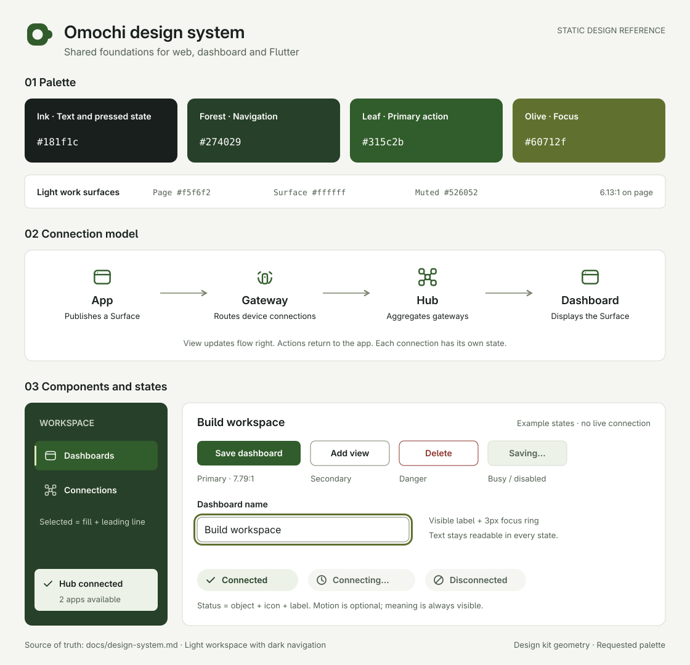
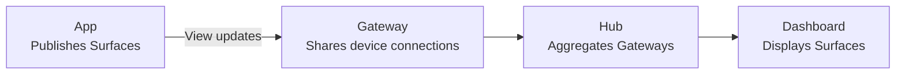

# Omochi design system

[Overview](../README.md) · [Architecture](architecture.md) · [Discovery and dashboards](discovery.md)

Initial design specification for [issue #5](https://github.com/omochi-ui/omochi/issues/5).
Deep greens and light backgrounds support readable controls and connection states
in a development tool. The website, dashboard, development preview, and future
Flutter clients share color roles, typography, spacing, component states, and
terminology.

This specification covers documentation and static samples. Applying it to the
existing UI, implementing theme tokens in code, and Flutter implementation are
separate tasks. The initial design uses light work surfaces and dark navigation;
a full dark theme is outside its scope.

[Full-size sample](assets/design-system.png) · [SVG source](assets/design-system.svg) ·
[Icon editing and preview](assets/design-system/README.md). This is a specification
sample, not a screenshot of an implemented screen. The document displays the
exported PNG; the editable SVG references individual icon files.

## Design principles

- **Make actions clear.** Prioritize readable text, verb-led action names, and
  visible focus. Show saving, selection, and connection attempts through text
  or shapes as well as color.
- **Make connections visible.** Give Surface, Gateway, and Hub distinct shapes,
  and identify connected objects by name. A Hub connection alone does not imply
  that everything beneath it is healthy.
- **Keep the tool calm.** Greens, lightly tinted backgrounds, and moderate corner
  radii evoke warabi mochi and matcha. Avoid mascots, bouncing motion, and
  continuously blinking decoration.

## Color tokens

Separate colors into a palette of values and semantic tokens that describe their
purpose. Components reference semantic roles. Use the dotted names below as
shared identifiers; on the web, `color.accent.solid` becomes
`--omochi-color-accent-solid`.

### Base palette

Use the four user-specified colors unchanged. Assign a role to each rather than
treating them as an evenly spaced lightness scale.

| Palette name | Value | Main uses |
| --- | --- | --- |
| `palette.ink` | `#181f1c` | Body text, strong headings, pressed primary actions |
| `palette.forest` | `#274029` | Dark navigation, primary-action hover |
| `palette.leaf` | `#315c2b` | Primary actions, links, selection emphasis |
| `palette.olive` | `#60712f` | Focus on light surfaces, secondary brand accents |

Olive is a brand color, not a warning color. Use `leaf` for primary-action fills.

### Supporting palette

| Palette name | Value | Uses |
| --- | --- | --- |
| `palette.white` | `#ffffff` | Cards, inputs, text on primary actions |
| `palette.paper` | `#f5f6f2` | Page backgrounds, text on dark surfaces |
| `palette.mist` | `#edf2e8` | Hover, selection, supporting-information backgrounds |
| `palette.line` | `#d6ddcf` | Decorative separators, card outlines |
| `palette.sage` | `#7a846e` | Control boundaries |
| `palette.slate` | `#526052` | Supporting text, placeholders, disconnected-state text |
| `palette.pale` | `#cbd3c6` | Supporting text on dark surfaces |
| `palette.lime` | `#dce8b9` | Focus and selection indicators on dark surfaces |
| `palette.amber` | `#745512` | Warning text and icons |
| `palette.amberWash` | `#fff7df` | Warning backgrounds |
| `palette.red` | `#8b342b` | Error and deletion text/icons |
| `palette.redWash` | `#fff1ed` | Error backgrounds, destructive-action hover |

### Semantic assignments

Values below reference `palette.*`. Treat dark navigation as an independent
region without changing the colors of the light work surface.

| Token | Reference | Uses |
| --- | --- | --- |
| `color.bg.page` | `paper` | Whole page |
| `color.bg.surface` | `white` | Cards, inputs |
| `color.bg.raised` | `white` | Menus, dialogs |
| `color.bg.subtle` | `mist` | Code, supporting information |
| `color.bg.inverse` | `forest` | Navigation |
| `color.text.primary` | `ink` | Body text, headings |
| `color.text.secondary` | `slate` | Supporting text, placeholders |
| `color.text.inverse` | `paper` | Body text on dark surfaces |
| `color.text.inverseSecondary` | `pale` | Supporting text on dark surfaces |
| `color.border.subtle` | `line` | Noninteractive card outlines |
| `color.separator` | `line` | Information separators |
| `color.border.control` | `sage` | Input and secondary-button borders |
| `color.accent.solid` | `leaf` | Primary-action fills, selected dark-navigation background |
| `color.accent.solidHover` | `forest` | Primary-action hover |
| `color.accent.solidPressed` | `ink` | Pressed primary actions |
| `color.accent.onSolid` | `white` | Primary-action text |
| `color.accent.text` | `leaf` | Underlined links |
| `color.accent.subtle` | `mist` | Selection backgrounds on light surfaces |
| `color.selection.indicator` | `leaf` | Selection indicators on light surfaces |
| `color.selection.inverseIndicator` | `lime` | Selection indicators on dark surfaces |
| `color.focus` | `olive` | Outer focus rings on light surfaces |
| `color.focus.inverse` | `lime` | Outer focus rings on dark surfaces |
| `color.disabled.bg` | `mist` | Disabled-control backgrounds |
| `color.disabled.text` | `slate` | Disabled-control text |
| `color.disabled.border` | `line` | Disabled-control borders |
| `color.status.positive.text` | `forest` | Checkmarks, Connected/Saved labels |
| `color.status.positive.bg` | `mist` | Confirmed-state backgrounds |
| `color.status.neutral.text` | `slate` | Disconnected, connecting, unknown-state text |
| `color.status.neutral.bg` | `paper` | Neutral-state backgrounds |
| `color.status.warning.text` | `amber` | Warning text, icons, and required borders |
| `color.status.warning.bg` | `amberWash` | Warning backgrounds |
| `color.status.danger.text` | `red` | Error/deletion text, icons, and borders |
| `color.status.danger.bg` | `redWash` | Error backgrounds |

Pair status text with icons and keep areas of strong fill small. Do not use red
badges for ordinary disconnected states. In dark navigation, use the light badge
backgrounds above rather than placing red or olive text directly on dark surfaces.

### Contrast

Provide at least 4.5:1 for ordinary text and 3:1 against adjacent colors for
boundaries and shapes needed to identify controls or states. Headings should
normally use the same color combinations as ordinary text. These requirements
follow W3C guidance on [text contrast](https://www.w3.org/WAI/WCAG22/Understanding/contrast-minimum.html)
and [non-text contrast](https://www.w3.org/WAI/WCAG22/Understanding/non-text-contrast.html).

The ratios below use relative luminance of opaque sRGB colors. Display values
are rounded to two decimal places; pass/fail uses the unrounded result.

| Foreground | Background | Ratio | Use and threshold |
| --- | --- | --- | --- |
| `#181f1c` | `#f5f6f2` | 15.46:1 | Body text, 4.5:1 |
| `#526052` | `#f5f6f2` | 6.13:1 | Supporting text, 4.5:1 |
| `#526052` | `#ffffff` | 6.66:1 | Input placeholders, 4.5:1 |
| `#ffffff` | `#315c2b` | 7.79:1 | Primary actions, 4.5:1 |
| `#ffffff` | `#274029` | 11.34:1 | Primary-action hover, 4.5:1 |
| `#ffffff` | `#181f1c` | 16.78:1 | Pressed primary actions, 4.5:1 |
| `#315c2b` | `#edf2e8` | 6.85:1 | Selected text, 4.5:1 |
| `#7a846e` | `#ffffff` | 3.92:1 | Input borders, 3:1 |
| `#7a846e` | `#f5f6f2` | 3.61:1 | Control borders on the page, 3:1 |
| `#60712f` | `#f5f6f2` | 4.96:1 | Focus, 3:1 |
| `#f5f6f2` | `#274029` | 10.45:1 | Dark-navigation text, 4.5:1 |
| `#cbd3c6` | `#274029` | 7.38:1 | Dark-navigation supporting text, 4.5:1 |
| `#dce8b9` | `#315c2b` | 6.04:1 | Dark-navigation selection indicators, 3:1 |
| `#8b342b` | `#fff1ed` | 7.26:1 | Errors, 4.5:1 |
| `#745512` | `#fff7df` | 6.43:1 | Warnings, 4.5:1 |

`#315c2b` against `#274029` is **1.46:1**. A selected background in dark
navigation must therefore include a 3px `inverseIndicator` and selection
semantics. Do not use `color.border.subtle` to identify controls. Preserve the
defined color combinations rather than lowering opacity for entire labels or states.

## Typography and dimensions

### Typography

Use the OS sans-serif font by default. The web stack is
`system-ui, -apple-system, BlinkMacSystemFont, "Segoe UI", "Hiragino Sans", "Yu Gothic UI", sans-serif`.
Existing Inter may be used when that font is served. Code and identifiers use
`ui-monospace, "SFMono-Regular", Consolas, monospace`. Japanese uses the same
role-based sizes and a body line height of 1.6.

| Token | Base size | Line-height multiplier | Weight | Uses |
| --- | --- | --- | --- | --- |
| `type.display` | 48 | 1.2 | 600 | Short website headlines; 32 on narrow screens |
| `type.title` | 32 | 1.3 | 600 | Page headings; 28 on narrow screens |
| `type.heading` | 24 | 1.3 | 600 | Section headings |
| `type.panel` | 16 | 1.5 | 600 | Panel headings |
| `type.body` | 16 | 1.6 | 400 | Body text, inputs |
| `type.control` | 14 | 1.5 | 600 | Buttons, navigation |
| `type.meta` | 13 | 1.5 | 400 | Supporting text, update times |
| `type.code` | 14 | 1.6 | 400 | Code, IDs |

On the web, use `rem` relative to a 16px base; Flutter uses logical sizes and
follows OS text scaling. Inputs remain at least equivalent to 16px on mobile.
Text regions with three or more lines need a line height of at least 1.4.
Japanese normally uses zero letter spacing; large Latin headings may tighten
to `-0.02em` at most.

Aim for 60–75 Latin characters or 35–45 Japanese characters per line of
explanatory text. Use tabular figures for changing numbers. Wrap long names and
IDs; do not hide required full text behind only a `title` attribute. When
providing details or copy actions, retain a way to inspect what was copied.

### Spacing and layout

| Token | Value | Uses |
| --- | --- | --- |
| `space.1` | 4 | Icon internals, closely related supporting text |
| `space.2` | 8 | Icon-to-label and label-to-input spacing |
| `space.3` | 12 | Between actions |
| `space.4` | 16 | Card padding, panel gaps, narrow-screen outer margins |
| `space.6` | 24 | Dialog padding, form-field spacing |
| `space.8` | 32 | Wide-screen outer margins, section spacing |
| `space.12` | 48 | Website section spacing |
| `space.16` | 64 | Large website section spacing |

Units correspond to CSS pixels on the web and logical pixels in Flutter.
Normally leave at least twice the internal spacing between groups. Minimum
control targets are 40×40 on desktop and 48×48 for touch. Add surrounding space
rather than enlarging the icon itself.

Following the dashboard's current structure, start with 232px navigation, a
12-column work area, and 16px panel gaps on wide screens. At 760px or below,
stack panels in one column and use an explicitly expandable navigation list.
Keep connection status and primary actions visible. Panel order must match
screen-reader and keyboard order.

At 320 CSS px, the page must remain operable without horizontal scrolling.
Indicate local scrolling for wide content such as diagrams or logs. Use the
[W3C reflow criterion](https://www.w3.org/WAI/WCAG22/Understanding/reflow.html)
as a check. Prevent fixed-height clipping at 200% text scaling, with long names,
and in both English and Japanese.

### Corner radii and shadows

| Token | Value | Uses |
| --- | --- | --- |
| `radius.small` | 4 | Small tags, code |
| `radius.control` | 8 | Buttons, inputs, navigation items |
| `radius.card` | 12 | Cards, panels |
| `radius.dialog` | 16 | Dialogs |
| `radius.pill` | 999 | Status badges only |
| `border.width` | 1 | Borders, separators |
| `focus.width` | 3 | Focus rings |
| `focus.offset` | 3 | Gap between control and ring |
| `shadow.none` | none | Inputs, ordinary buttons, navigation |
| `shadow.surface` | `0 1px 2px rgb(0 0 0 / 6%), 0 2px 4px rgb(0 0 0 / 4%)` | Work-area cards |
| `shadow.overlay` | `0 8px 24px rgb(0 0 0 / 16%)` | Dialogs, menus |
| `color.bg.scrim` | `rgb(24 31 28 / 40%)` | Modal backdrop; do not overlay text |

Choose radii for each surface's size. For nested concentric surfaces, set the
outer radius to the inner radius plus padding plus border width. Inputs use
borders rather than shadows to establish boundaries. Surfaces with shadows must
retain a visible boundary in forced-colors mode.

## Basic components and states

### Shared interaction states

| State | Appearance and behavior |
| --- | --- |
| Default | A label that explains the purpose; normal background and border |
| Hover | Only for hover-capable pointers; change backgrounds only on interactive controls |
| Pressed | Primary actions use `accent.solidPressed`; others emphasize the border without moving text or layout |
| Focus | Keep the current state and add a 3px outer ring with a 3px gap; use `:focus-visible` on the web and `focus.inverse` on dark surfaces |
| Disabled | Use `disabled.*`, reject interaction, explain the reason in adjacent text, and omit hover/pressed effects |
| Loading | Retain the operation name, such as “Saving…”, prevent duplicates, and avoid large layout shifts when labels change |
| Selected | Selection background plus a 3px leading line or checkmark; distinguish from hover and expose selection to assistive technology |
| Error | Danger text/icon with the problem and recovery steps; use more than color and preserve input |

Focus can coexist with hover, selection, and errors. Do not replace an error
border with a focus ring. Disable only unavailable actions; do not disable
submission solely because input is incomplete. Explain field-specific issues
on submission.

### Buttons and links

| Type | Default | Hover | Pressed | Uses |
| --- | --- | --- | --- | --- |
| Primary | `accent.solid` + `accent.onSolid` | `solidHover` | `solidPressed` | Save, create, etc.; one for the main task at that moment |
| Secondary | `bg.surface` + `text.primary` + `border.control` | `bg.subtle` | `bg.subtle` + `selection.indicator` border | Cancel, add, reload |
| Quiet | Transparent + `text.primary`, inside toolbars | `bg.subtle` | `bg.subtle` + `selection.indicator` border | Supporting actions; not in body text |
| Danger | `bg.surface` + `status.danger.text` text and border | `status.danger.bg` | Same background + 2px inner border | Delete, remove trust, and other actions that discard results |
| Link | `accent.text` + underline | Emphasized underline | Retain underline | Navigate to pages or details |

Standard buttons use 8px vertical and 16px horizontal padding with a minimum
height of 40px. Leave 8px between icon and label. Icon-only buttons need action
names such as “Close” or “Remove view”.

Separate destructive actions from primary actions in ordinary screens. For
irreversible deletion, identify the target and what will be lost in a
confirmation with “Delete” and “Cancel”. Deleting a dashboard removes its saved
layout; it does not stop connected applications.

### Inputs

Inputs use `bg.surface`, `text.primary`, `border.control`, an 8px radius, and
8px vertical/12px horizontal padding. Hover uses a `selection.indicator` border;
focus uses the shared ring. Provide a permanently visible label and use
placeholders only for examples.

Combine a danger border with recovery text immediately beneath the input.
Prefer “Enter a dashboard name” to “Invalid name”. On the web, associate labels,
help, and errors with the input, and set `aria-invalid` on error. Read-only inputs
remain selectable and copyable, distinct from disabled inputs.

### Cards and panels

Cards normally use a white surface, 12px radius, 16px padding, and a subtle
shadow. Noninteractive cards have no hover effect or pointer cursor. Clickable
cards need control borders and focus; their hit areas must not overlap separate
buttons inside the card.

A Surface panel heading includes its icon, name, source device/app, and that
Surface's state. Preserve panel position and name after losing the connection,
and show “Unavailable” with recovery steps. If retaining old values, add a
“Last received” time and do not label them Live.

Provide alternatives to dragging for moving and resizing panels. If narrow
screens cannot edit saved layouts, explain why while preserving content viewing
and ordinary interactions.

### Navigation and dialogs

Navigation uses `bg.inverse` and `text.inverse`. Hover uses `accent.solid`;
selection adds a 3px `selection.inverseIndicator` and bold text on the same
background. Use `aria-current` on the web. Wrap long names or provide a list
where users can read them in full.

Use 560px as a suggested maximum dialog width, with at least 16px on either
side of the viewport, 24px padding, and a 16px radius. Include a heading and
close control, and indicate scrolling for long contents. Move focus inside on
open and return it to the trigger on close. Escape closes the dialog; confirm
when unsaved edits would be discarded. Prefer native modal dialogs on the web.

### Empty lists and operation states

| Situation | Example text | Next action |
| --- | --- | --- |
| Initial loading | “Loading dashboards…” | Prevent duplicate requests; distinguish from an empty list |
| No dashboards | “No dashboards yet. Bring your app views together here.” | “Create dashboard” |
| No Surfaces | “No published views. Start an app on the connected device.” | Link to startup instructions |
| No search results | “No views match ‘build’.” | “Clear search” |
| Saving | “Saving…” | Prevent duplicate saves |
| Saved | “Saved” | Resume normal interaction without stealing focus |
| Save failure | “Could not save. Check the connection and try again.” | “Retry”; preserve edits |

Announce routine status updates politely and clearly announce errors that block
interaction. Do not repeat announcements on every reconnect attempt. Notifications
with recovery actions or important information must not disappear automatically.

## Connection representation and icons

### Objects and relationships

A Surface is an independent view published by an app. A Gateway shares access
to apps on a device; a Hub aggregates Gateways and delivers their views to a
dashboard. Do not depict a Surface as a network server. Follow the
[current architecture](architecture.md):

Arrows show the direction of updates; actions travel in reverse. A single-app
development preview uses a separate bridge path, so do not insert a Gateway
or Hub that does not exist in that path.

### Design-kit adoption

Use the supplied `../../omochi-design-kit`, relative to the repository root, as
the shape reference. The sample's `surface.svg`, `gateway.svg`, `hub.svg`, and
`omochi-mark.svg` are individual files in
[assets/design-system](assets/design-system/README.md), referenced externally
with `<use>`. Functional icons inherit `currentColor` from the referring element.
The original kit is unchanged.

| Kit file | Meaning | Example uses |
| --- | --- | --- |
| `surface.svg` | View with a frame and header | Panels, view picker |
| `gateway.svg` | Device that mediates connections | Gateway lists, connection paths |
| `hub.svg` | Center aggregating several destinations | Hub status, connection overview |
| `device.svg` | Device running an app | Source, local/remote distinction |
| `grid.svg` | View arrangement | Dashboard navigation |
| `attach.svg` | Connect or add an object | Connections, adding views |
| `discover.svg` | Find an object | Discovery, search |
| `trust.svg` | Registered trust relationship | Trust details; not a substitute for connected status |
| `health.svg` | App-reported health | Health checks, distinct from transport connectivity |
| `action.svg` | Run an action | Command execution |
| `refresh.svg` | Refresh or retry | Reload lists |
| `terminal.svg` | Commands and logs | Command examples, log areas |

Functional icons use a 24×24 drawing, 1.8 stroke width, and round line caps;
at 20px display size the stroke is about 1.5px. Meaningful icons normally display
at 20px or larger. For 16px locations, validate a separate simplified shape first.
Fills and strokes share a `currentColor`-equivalent color inherited from the
context's token.

Always name unfamiliar objects. Icons beside names are decorative and should
not duplicate screen-reader output. Keep object shapes constant across states
and attach a separate status badge.

Keep the logo's rounded ring and connector from the kit. The sample uses `leaf`
for the normal fill and `paper` for the hole to match its background. On dark
surfaces use `lime` for the fill and `forest` for the hole. The kit's original
`#256B4D`/`#B9DBC8` differ from this palette and are not adopted directly as
product tokens. Preserve aspect ratio, leave clear space of at least one-quarter
of the mark's width, and add no facial expressions or bouncing animation.

### Connection states

| State | Text and shape | Color | Display condition |
| --- | --- | --- | --- |
| Connecting | Clock + “Connecting…” | neutral | A connection attempt has verifiably started |
| Connected | Checkmark + “Connected” | positive | Connection to that object is confirmed |
| Reconnecting | Refresh arrow + “Reconnecting…” | neutral | A retry after disconnection is confirmed |
| Disconnected | Slashed circle + “Disconnected” | neutral | No connection; include a reason and next action |
| Error | Exclamation mark + “Connection error” | danger | Failure information is available and action is needed |
| Unknown | Question mark + “Unknown state” | neutral | Information is unavailable or stale |

The 12 concept icons do not include this full status set. The sample uses
`check.svg`, `clock.svg`, and `offline.svg` for its checkmark, clock, and
disconnected symbols. Match their caps and stroke width for remaining status
symbols. Do not rely on a continuously animated spinner to communicate state.

Name the object in status text: “Connected to Hub”, “Gateway workstation is
disconnected”, or “Surface health is available”. A Surface is available only
when the Hub connection, source-service connection, and existence of that
Surface are confirmed. Do not infer an entire Gateway's state from one Surface.

Current [ServiceView](../packages/hub-ui/src/services.ts) includes service
`connected`/`disconnected`/`error` states and device information, but no separate
Gateway diagnostic state. In detailed connection-path views, display “Unknown
state” or “No information” for unavailable segments. Discovery, enrollment,
connectivity, and application health are separate concepts.

## Motion

| Token | Value | Uses |
| --- | --- | --- |
| `motion.instant` | 0ms | Input, tab navigation, number updates, connection-status text |
| `motion.feedback` | 100ms | Button background/border colors |
| `motion.easing` | `ease-out` | Brief interaction feedback |

Movement, scaling, bouncing, and continuous blinking are not standard effects.
Text, shapes, or selection indicators must remain after state changes. Reduced
motion also sets `motion.feedback` to 0ms. If theme switching is added, stop
color transitions and switch all colors together. Treat web
`prefers-reduced-motion` and Flutter OS settings with the same intent.

## Rules shared across clients

| Area | Website | Dashboard and preview | Flutter |
| --- | --- | --- | --- |
| Color | Same semantic tokens; establish character through large backgrounds | Same semantic tokens; keep work surfaces light | Map the same values and meanings to the theme |
| Typography | Display text and wider body columns are allowed | Organize mainly with title and smaller roles | Same role-based sizes and weights; allow OS text scaling |
| Spacing | Use 48/64 for section gaps | Mainly 8/16/24 | Same scale; touch targets at least 48 |
| Interaction | Links navigate; buttons perform operations | Distinguish editing, saving, and connecting | Respect platform interaction, focus, and back behavior |
| Status | Explain diagrams and provide legends | Include object name, state, and recovery action | Same vocabulary and symbols; notify assistive technology |
| Icons | Preserve kit shapes and clear space | Separate object icons from status symbols | Same shapes, scaling with text |

Share visual meaning and action outcomes rather than fixed-pixel screen copies.
Also consult Flutter's [official accessibility guidance](https://docs.flutter.dev/ui/accessibility)
for announcements, text scaling, and target sizes.

For web implementation, map shared tokens to the
[renderer](../packages/renderer/src/styles.css) A2UI variables and have
[hub-ui](../packages/hub-ui/src/styles.css) and
[dev-server](../packages/dev-server/src/index.css) use the same foundation.
Separate host UI and Surface scopes so Hub CSS does not indiscriminately
override embedded Surface `button` or `input` elements. Map application-specific
catalogs to the foundation tokens while preserving each app's semantics.

## Implementation checks

At this stage, verification covers color values and static samples. After
applying the specification to each client, check actual screens for acceptance:

- Measure real text, placeholder, border, and focus combinations, including
  opacity and overlap with hover, selection, and errors.
- Use only the keyboard to create, add views, edit, save, confirm deletion, and
  close dialogs. Keep focus visible and verify its destination after closing.
- Verify that screen readers convey action names, roles, selection, and errors.
  Do not leave icon-only actions unnamed or inputs unlabeled.
- At 320px width, 200% text scaling, long names, and in Japanese/English, retain
  all content and controls. Mobile remains operable with the keyboard open.
- Separately test Hub disconnection, service-only disconnection, Surface removal,
  and status-fetch failure. Do not label disconnected objects Live or Connected.
- Provide a next action for empty lists, loading, saving, save failures, no search
  results, and unavailable actions.
- Retain boundaries, selection, status, and focus with reduced motion and
  forced-colors mode.

The dashboard, renderer, and development preview currently retain their own
CSS values. Do not claim product-wide adoption or accessibility conformance
until migration and verification on actual screens are complete.
